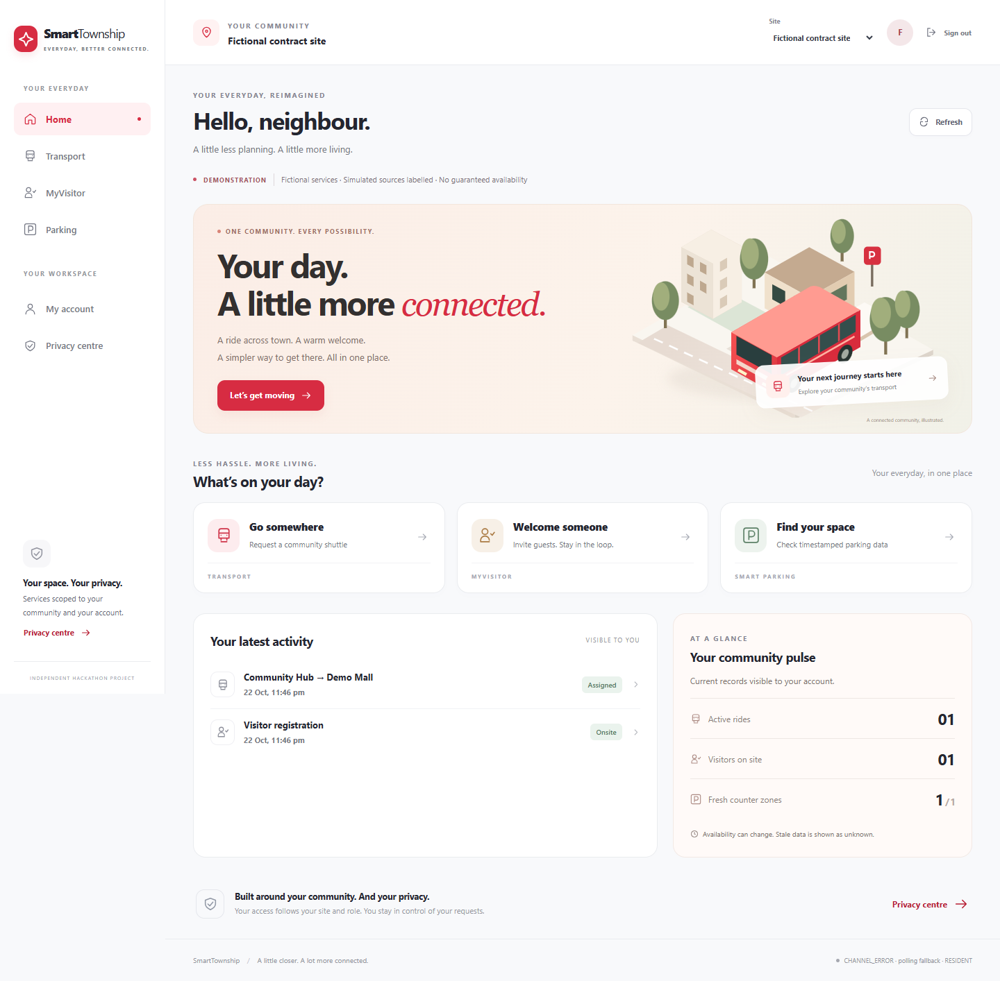

# SmartTownship

Visitor registration, transport operations and parking share Supabase identity and tenant/site authorization. **Prototype: release gates remain open.** On 2026-10-20 a dedicated hosted Supabase development project was connected, all 16 migrations applied and database health checked. The 300 SQL assertions, fictional account seed, live service/browser tests and Render frontend deployment remain pending.

For the new Render Static Site, use [render-static.yaml](render-static.yaml) and [Render setup](docs/RENDER_DEPLOY.md); the existing [render.yaml](render.yaml) is optional IoT only. Continue with the Windows [setup guide](docs/SETUP_HOSTED.md) for hosted tests and fictional account provisioning. SmartTownship uses **http://127.0.0.1:5174**, strict port. Leave **5173 and 5000** for AppointHub. Core workflows need hosted Supabase; the optional device bridge uses 3001 and is not required for the demo.

## Red-and-white UI redesign

The responsive super-app redesign is implemented and locally tested. See the [detailed redesign, working/not-working and pitch readiness report](docs/REDESIGN_AND_PITCH_REPORT.md) for screenshots, all module statuses, sample-data instructions and remaining gates.



Current local checks: **84 unit, 36 runtime, 53 browser contract and 3 setup tests pass**, alongside build/typecheck/lint/HTTP smoke. Hosted SQL/service verification and the live dependency audit remain blocked in this workspace. After hosted acceptance passes, the new `npm run demo:pitch` adds fictional visitors, trips, a timetable and parking through real authenticated APIs; it has not yet run against a database.

## Local checks

Dependencies and lockfile are present. Use npm ci for a clean checkout. Node 22.18+ is the target; this workspace's checks used Node 25.5.0, so target-runtime qualification remains pending.

```sh
npm run verify:local -- --audit-unavailable
npm run simulate:dispatch
```

The verification command runs build, actual local HTTP smoke, TypeScript, lint, unit/runtime and production-browser checks serially. It then attempts hosted checks and records a nonzero result for missing configuration. The audit flag explicitly marks the previously unavailable advisory endpoint as blocked; it never means a security pass. Run npm audit --audit-level=high in normal PowerShell when available.

Current evidence and any failures: [TEST_EVIDENCE.md](docs/TEST_EVIDENCE.md). Unit/runtime and synthetic browser responses do not prove database enforcement. Vitest uses at most two workers to avoid excessive local resource use.

## Hosted development command order

After setting the variables in the setup guide, including APP_ENV=test, DEMO_SEED_ACK=fictional-data-only and DEMO_MODE=true:

```sh
npm run db:migrate
npm run demo:configure
npm run test:integration
npm run db:seed:demo
npm run test:services
npm run test:e2e
npm run dev
```

Run each command only after the previous one succeeds. The **16 migration files were applied to the dedicated hosted development database on 2026-10-20**; **300 authored pgTAP assertions remain unverified**. The migration script should recognize already-applied files; stop if its ledger/hash check disagrees. Seed is additive and creates fictional accounts; repeated seeds create more tenants, so do not rerun it casually. No reset is supplied. Browser tests own 5174; stop your SmartTownship dev server before running them.

## Source scope

Private invitations and displayed site QR flows, pinned visitor form versions, optional OTP simulation, guard assistance/entry/exit, search and masked export, staff/asset/site/tenant administration, authenticator MFA, privacy review/holds/minimization, parking hierarchy/bays/counters/manual expiry, signed HTTPS IoT ingestion, route timetables, capacity-safe assignment/reassignment, shift-bound GPS, aggregate reporting and a deterministic dispatch experiment now have source. [Current scope](docs/CURRENT_SCOPE.md) distinguishes those paths from unfinished work and external gates.

No real SMS, vehicles, sensor hardware, routing provider or MQTT broker is connected. Simulation must be enabled in the private development database setting and remains labelled. The dispatch experiment reports executed fictional outcomes, not real travel improvements. No deployment, purchase or real personal-data collection occurred.

Architecture: static React/Vite on the planned Pages host, Supabase Auth/PostgreSQL/RPC/RLS/Realtime, optional native Node signed-device bridge. Preserve this repository's architecture rather than converting to the preferred stack in codex.md. See [architecture](docs/ARCHITECTURE.md), [API](docs/API.md), [security](docs/SECURITY.md), [privacy](docs/PRIVACY.md), [operations](docs/OPERATIONS.md), [demo](docs/DEMO_SCRIPT.md), [plan](docs/IMPLEMENTATION_PLAN.md) and [release checklist](docs/PRODUCTION_CHECKLIST.md).
