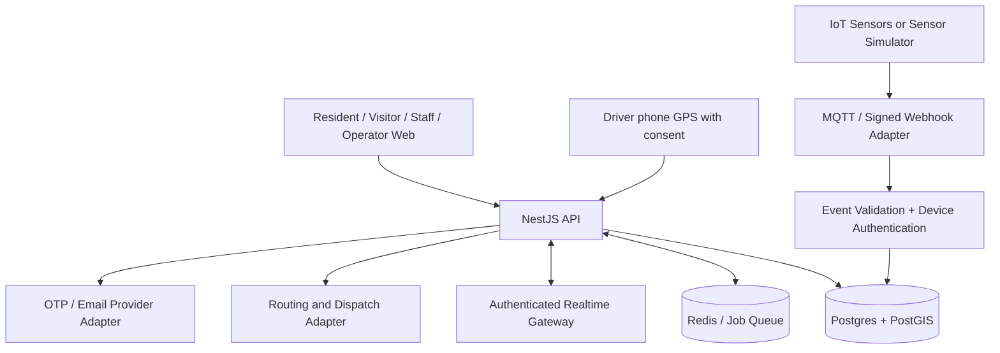

# codex.md — SmartTownship Platform

> **Status:** Master product and engineering specification for Codex.
> **Document version:** 1.0 · 19 October 2026
> **Product type:** Multi-tenant, mobile-first smart township platform (software-first; IoT-ready).
> **Primary pilot:** Sime Darby Property hackathon, Problem Statement 1 — People. The product is independently branded and must not imply approval or an official integration with Sime Darby Property.
> **Instruction:** Build a real, tested application. Do not deliver only mockups, screenshots, placeholder APIs, or a polished frontend disconnected from working backend behavior.

---

## 0. Instructions to the coding agent — READ FIRST

Act as the **principal engineer, product architect, security reviewer, UX lead, and QA lead** working on this product. Your job is to deliver maintainable, deployable software, not just a demonstration.

**Before making edits:**
1. Inspect the repository: `pwd`, tree, package files, Git status, existing instructions, tests, environment and deployments. Respect any existing `AGENTS.md` and the user's work. Never overwrite a functioning application blindly.
2. If the repository is empty, create the architecture specified below. If the repo already has a compatible architecture, adapt and preserve it rather than unnecessarily rewriting it.
3. Maintain `docs/IMPLEMENTATION_PLAN.md` with phases, dependencies and explicit acceptance criteria. Maintain `docs/DECISIONS.md` for material technical choices and `docs/PROGRESS.md` for what's implemented, tested, and blocked.
4. Implement vertical slices **end-to-end**: schema + migration + API + authorization + interface + tests + docs. Do not build every page with dead buttons before functionality exists.
5. At the end of each phase, execute relevant commands (lint, typecheck, tests, build, migrations). Fix failures before moving on. Do not claim checks passed unless they actually ran and passed.
6. If an external API, real OTP vendor, real IoT hardware, production hosting credentials, transport partner, or legally approved privacy copy is unavailable, create a clearly marked **development simulator / provider interface**. Never fabricate integration or production-readiness.
7. Do not expose secrets, credentials, personal data, or access tokens in committed files, logs, client bundles or test fixtures. Use `.env.example` with names only and secret management in deployed environments.
8. Do not perform destructive operations on user data, deploy to production, purchase services, or merge/push to remote repositories without explicit approval. Do not run `prisma migrate reset`, drop databases, or delete existing resources without approval. Prefer additive migrations and backups.
9. Work autonomously on sensible implementation details. For a genuine blocker, document it and continue with the highest-value independent tasks rather than stopping the entire project.
10. At each checkpoint report: completed functionality, changed files, commands run, verification evidence, unresolved risks, and next phase. **Never say "production-ready" without meeting the release gates in §17.**

**Delivery priority:** end-to-end correctness and security > transport / visitor / parking core workflows > operator intelligence > visual polish > speculative features.

---

## 1. Product vision and boundaries

### Working product name
**SmartTownship** (internal name; renameable without architecture changes).

### One-sentence concept
An integrated township operations platform connecting **live shuttle tracking**, **QR-based visitor registration and verification**, and **real-time mall / parking availability**, controlled through secure **operator, admin, staff, driver and resident roles**, with future compatibility for physical IoT sensors.

### Modules
1. **Mobility:** A resident sees available transport, requests a ride or views fixed routes; a driver operates assigned trips and shares consented, shift-bound location; authorized operators monitor availability, assign rides and analyze service demand.
2. **MyVisitor:** A resident can invite a visitor; a visitor opens an accessible QR-linked web form without installing an app; staff verify and record entry/exit; admins configure forms and searchable, access-controlled records. Optional OTP helps verify phone control but is **not proof of legal identity**.
3. **Smart Parking / Mall:** Visitors see parking facility, level and zone availability; mall staff manage facilities; authenticated IoT adapters ingest sensor or gate-counter events; system identifies available spaces **only to the granularity actually supported by source data**.
4. **Operations & Analytics:** Township/site dashboards, roles, facility configuration, alerts, audit history and useful cross-module service metrics. Privacy-safe aggregated analysis, not an unrestricted personal-data surveillance dashboard.

### Target users
- Platform Operator: product provider's authorized system administrator.
- Township Admin: authority for an assigned township/tenant.
- Site Manager: authority for specific sites (e.g., gated residence, mall, car park).
- Staff: security guard, visitor desk, mall/parking attendant, transport dispatcher (capabilities assigned by role + site).
- Driver: assigned vehicle/shift and trip workflows only.
- Resident / Registered User: own travel, invitations and permitted township services.
- Visitor / Guest: no account necessary for QR self-registration; only sees their own flow and confirmation.

### Explicit non-goals for first working release
- Designing or manufacturing sensors, Arduino, ESP32, Raspberry Pi or other electronics.
- Autonomous vehicles, biometric / face recognition, ANPR / license-plate recognition, CCTV analytics, or national identity verification.
- Payments, full ride-hailing marketplace, parking reservation/guarantee, government data integrations or automatic gate-barrier actuation.
- Pretending a digital QR code alone proves that a person is who they claim to be.
- Pretending a mall's counter-based estimate identifies an individual free bay.
- Building unbounded AI features, unrestricted NL-to-SQL, or exposing PII to third-party AI models.

### Demo versus live deployment
Support **`DEMO_MODE` restricted to non-production**, clearly labeled in UI and API responses. Seed fictional residents, vehicles, guests, sites and parking sensor events. All real-time demo behaviors use real APIs/database/streaming paths, **not frontend-only animations**. In production, disabled simulation cannot be toggled by a user, URL parameter or browser console.

---

## 2. Product principles (non-negotiable)

- **Production engineering:** No arbitrary hard-coded passwords, master bypass, fake success toast, insecure "temporary" endpoint or untested protected route.
- **Tenant isolation:** Every write and private read is scoped to the correct tenant and site. Verify authorization at the API/service layer for every operation; UI hiding is insufficient.
- **Mobile-first:** Most visitors/residents/guards use phones; desktop is important for operator dashboards. Layout must not overflow or clip at typical 360px, 768px and desktop widths.
- **Graceful degradation:** Service failures, offline sensors, denied GPS, unavailable OTP provider and stale data must produce explicit safe states and recovery paths.
- **Privacy by default:** Minimum necessary visitor fields, masked PII, defined retention, auditable access and restricted export. Apply Malaysia's applicable privacy requirements with qualified review before real launch.
- **Source truth:** Display timestamp, freshness, sensor accuracy and `simulated` status where relevant. No made-up live shuttle times or fabricated parking availability.
- **Accessible UX:** Target WCAG 2.2 AA where practical; labels, keyboard paths, focus states, high contrast, readable typography and clear language.
- **No vendor lock-in by accident:** Provider adapters for maps, routing, SMS/OTP, email, MQTT and analytics, with local fallbacks.

---

## 3. System architecture — preferred stack

Use a **TypeScript monorepo with a modular backend**, not an unnecessarily distributed microservice mesh.

| Layer | Preferred choice | Notes |
|---|---|---|
| Monorepo | pnpm workspaces + Turborepo | Reusable contracts/config and independent app builds |
| Resident / public / admin web | Next.js App Router, React, TypeScript | Responsive PWA-capable frontend; strict TypeScript |
| UI | Tailwind CSS, accessible component primitives, shadcn/ui patterns | Consistent design tokens, no oversized or clipped layouts |
| Server API | NestJS + REST/OpenAPI | Modular domain structure, structured validation/guards |
| DB | PostgreSQL + PostGIS | Tenant-scoped data, spatial lookups and migrations |
| ORM | Drizzle ORM **or** repository's proven ORM | If using spatial SQL, isolate typed raw PostGIS queries and test them |
| Background jobs | Redis + BullMQ | Notifications, cleanup, exports, assignment jobs |
| Real-time | Socket.IO or native WebSocket gateway | Authenticated subscriptions, room/tenant authorization |
| IoT ingestion | MQTT v5-compatible adapter + signed HTTPS event adapter | Separate ingestion from normalized occupancy state |
| Mapping | MapLibre GL JS + OpenStreetMap-compatible tiles | Respect attribution and tile-provider usage terms |
| Routing | Provider interface; OSRM/Valhalla-compatible provider as configured | Honest fallback for demo; don't invent driving distances |
| Optimization | Deterministic feasible-assignment algorithm first | Later add OR-Tools adapter; avoid premature ML complexity |
| API schema | OpenAPI + shared Zod/types or generated clients | No manually divergent frontend/backend data models |
| Testing | Vitest/Jest, Supertest, Playwright, Testcontainers when feasible | Unit, integration, tenant isolation and full E2E |
| Tooling | ESLint, Prettier, TS strict, conventional migrations | Audit, CI and runbook |
| Deployment | Dockerfiles + Docker Compose local; production deployment manifests/docs | Docker Compose is not automatically a production HA deployment |

If existing repo uses a comparable stack and it is stable, **preserve it** and document the deviation instead of converting everything.

### Suggested structure

```text
/
  AGENTS.md                   # Codex entry point
  codex.md                    # This product specification
  apps/
    web/                      # Next.js UI: public, resident, staff, admin, operator
    api/                      # NestJS API + WebSocket gateway
    worker/                   # BullMQ recurring jobs, exports, notifications
    simulator/                # Dev-only vehicles, demand, and sensor events
  packages/
    contracts/                # API types, Zod validation schemas, events
    ui/                       # Shared accessible UI components
    config/                   # ESLint, TypeScript and app configuration
    database/                 # Schema, migrations, seed scripts
    integrations/             # SMS, email, maps, MQTT, provider adapters
  infrastructure/
    docker/                   # Local Compose, secure sample configs
    deploy/                   # Explicit deployment templates / instructions
  docs/
    IMPLEMENTATION_PLAN.md
    PROGRESS.md
    DECISIONS.md
    ARCHITECTURE.md
    SECURITY.md
    PRIVACY.md
    API.md
    OPERATIONS.md
    DEMO_SCRIPT.md
    TEST_EVIDENCE.md
  .github/workflows/ci.yml
  .env.example
  README.md
```

### Architecture flow



---

## 4. Authentication, roles, and permission model

### Authentication
- First-party email + password for registered users. Hash with **Argon2id** with current reviewed parameters; never store plaintext/reversible passwords.
- Secure, HTTP-only, `Secure` cookies and suitable `SameSite`; CSRF protection for cookie-authenticated state changes. Use session rotation/revocation and documented expiration policy.
- Staff invitation flow: signed expiring invite, forced password setup, invitation revocation. Privileged accounts should use MFA before live operation.
- Refresh / session secrets managed server-side; logout and account disable revoke active sessions.
- Visitor QR flows are **public, purpose-limited token workflows**, not administrative login.
- Rate-limit login, password reset, OTP, QR and public form submissions; password recovery cannot enumerate accounts.

### Roles: global permission is not a substitute for tenant/site scope

| Role | Scope | Allowed actions |
|---|---|---|
| `PLATFORM_OPERATOR` | Approved global administrative scope | Manage tenants, platform health, integration configuration and platform audit; break-glass access separately audited; no default access to all visitor PII |
| `TOWNSHIP_ADMIN` | Assigned township | Manage sites, authorized staff, forms, transport configuration, aggregate reporting and township-level settings |
| `SITE_MANAGER` | Assigned site(s) | Manage site assets/staff within delegation, view authorized visits, parking and transport operations relevant to site |
| `STAFF` | Assigned site(s) + capability grants | Perform guard check-in/out, parking updates or dispatch actions only as explicitly granted |
| `DRIVER` | Own assigned shifts and vehicle | View assigned trips/stops, update trip status and share location during active shifts |
| `RESIDENT` | Own user identity and permitted township | Request/view own rides, invite own guests, view published parking/transport availability |
| `VISITOR` | Token-bound single flow | Register or view own confirmation; never query other visitors or logs |

Use capability permissions such as `visits.read.site`, `visits.checkin`, `parking.update.manual`, `fleet.dispatch`, `staff.invite`, `audit.read`, `exports.visits`, in addition to role membership. A `STAFF` member may have `GUARD`, `PARKING_ATTENDANT`, or `DISPATCHER` grants; don't give all staff every capability by default.

### Authorization requirements
- Authentication, current tenant context, membership, site access, record ownership and capability checked **server-side**.
- Deny by default; users cannot change own role or tenant via request payload.
- All queries of tenant data have explicit tenancy filters or verified database RLS context. If Postgres RLS is implemented, carefully test connection-pooling boundaries and fail-closed settings.
- No unrestricted user lookup across tenants; prevent IDOR by testing foreign UUID access.
- Maintain permission matrix tests for every protected endpoint. Export and analytics endpoints are not exceptions.
- Operator account management, data deletion and elevated actions require step-up confirmation and immutable audit records.

---

## 5. Module A — Mobility and real-time shuttle tracking

### Resident features
- Choose township, origin/allowed pickup stop, destination and travel preference.
- Display configured fixed routes and timetable when no on-demand transport operates.
- View vehicle location **only for publicly published routes or their own authorized ride**; show freshness (`live`, `delayed`, `offline`) and last-update time.
- Request a ride within a configured service area; see `requested -> accepted/assigned -> vehicle_en_route -> boarded -> completed` or `cancelled/rejected`.
- ETA derived from route engine / operational estimate with quality label; do not pretend guaranteed arrival.
- Booking history, cancellation within policy, status notifications and service unavailability explanation.
- Accessibility need can be specified; only assign capable vehicles. If no suitable vehicle exists, do not silently accept an impossible booking.

### Driver features
- Phone-first dashboard: active shift, assigned vehicle, stops, passenger counts, navigation link, start/finish trip, check-in boarding.
- Location permission is opt-in and **only active while the shift/trip is running**; provide visible location-sharing status and stop control.
- Emit GPS points with latitude/longitude, horizontal accuracy, recorded_at and shift/vehicle authorization over HTTPS/WebSocket.
- A smartphone browser may pause background GPS: mark updates stale rather than claiming 24/7 tracking. Provide a native-driver-app adapter path for reliable background tracking in later versions.
- Driver may only update own currently assigned vehicle/shift.

### Dispatcher/operator features
- Fleet table, vehicle capacities and accessibility attributes, shift assignment, routes, demand map, incident flags, active rides, cancellations.
- Dispatch request to compatible vehicle, manually reassign if necessary, display reason for automated recommendation.
- Detect conflicts (double assignment, overcapacity, incompatible access requirements, overlapping shifts).
- Simulate vehicle demand with realistic configured capacity, traffic assumptions and stops.

### Assignment algorithm (v1)
1. Filter vehicles by tenant, working status, active shift, service area, spare capacity and accessibility requirements.
2. Estimate travel time to pickup from configured routing provider (or clearly labeled deterministic demo travel matrix).
3. Score feasible options by ETA, detour, occupancy balance and configured maximum passenger waiting time.
4. Lock candidate booking/vehicle assignment transactionally; assign once using idempotent operation and conflict protection.
5. Record chosen decision, estimated wait, alternative count and reason in dispatch event.
6. Recalculate on cancellation, driver offline and timeout; do not infinite-retry.

A baseline fixed-service algorithm and adaptive dispatch strategy must both run against identical simulated demand for the hackathon experiment. Compute actual metrics from event logs; **never hard-code improvement percentages**.

### GPS and tracking safety
- Send updates at a configurable rate (e.g., 5–15 s while active); throttle and validate coordinates; limit history collection.
- Mark vehicle **stale** after configurable gap (e.g., 30–60 s) and **offline** after a longer configurable gap. Never interpolate forever or treat simulated positions as real.
- Restrict tracking access to authorized scopes; no globally readable driver location feed.
- Retain detailed GPS only as long as needed; aggregate stats thereafter per policy.

### Mobility API examples
- `GET /v1/mobility/routes`, `GET /v1/mobility/stops`
- `GET /v1/mobility/vehicles/available` (authorized/public-safe fields)
- `POST /v1/mobility/ride-requests`, `GET /v1/mobility/ride-requests/:id`
- `POST /v1/mobility/ride-requests/:id/cancel`
- `POST /v1/mobility/dispatch/assign` (dispatcher only)
- `POST /v1/mobility/shifts/:id/start`, `POST /v1/mobility/shifts/:id/end`
- `POST /v1/mobility/telemetry` (assigned driver only)
- WebSocket events `vehicle.location`, `ride.status`, `dispatch.assignment` with scoped rooms

**Acceptance:** two test residents request rides; dispatcher/algorithm assigns without overbooking; one driver starts shift and streams location; authorized residents see live updates and correct stale/offline behavior; cross-tenant users see nothing.

---

## 6. Module B — MyVisitor, QR-based visitor registration

### Supported entry models
1. **Resident invitation:** resident invites guest to approved location/date window. Create a random, expiring, single-use invite token with minimal data in QR URL.
2. **Public check-in QR:** authorized site displays QR to a short, site-specific form. Visitor self-registers, phone-verifies if enabled and receives a registration reference.
3. **Guard-assisted flow:** staff can register/check in visitor lacking smartphone or mobile signal, with access logging and explicit policy.
4. **Rotating QR (optional hardening):** a rotating, short-lived challenge minimizes reuse. Stationary QR remains supported with rate limits and server-side checks.

### Custom forms
- Township Admin / Site Manager selects template (`residential`, `office`, `contractor`, `event`) or creates controlled fields using an allowlisted form builder.
- Support required/optional, text, number, phone, date, single-select, checkbox, purpose of visit and vehicle registration when justified.
- Do not collect national IDs, passports, biometrics or sensitive data by default. If organization-specific forms require extra data, block risky field types pending admin confirmation and privacy review.
- Optional AI-assisted form draft: model suggests **field configurations only**, never directly publishes forms or receives visitor submissions. Human admin must approve. Without an AI key the deterministic template builder works fully.
- Enforce server-side schemas and validated field limits even if form is edited in a browser.

### Visitor journey
1. Visitor scans QR; app resolves site, purpose, notice, active form and token legitimacy.
2. Visitor fills minimal details and sees privacy notice and appropriate acknowledgement/consent where applicable.
3. Optionally verify control of phone via OTP (rate-limit, expiry, retries, secure verification, provider abstraction). No real SMS in demo by default.
4. Create a server-timestamped registration with `pending_verification` / `pending_entry` status.
5. Assigned guard compares visitor with required local entry policy and performs authenticated check-in. QR/OTP alone must not be marketed as identity proof.
6. At departure staff checks out; repeated check-in and expired invite produce safe, explicit errors.
7. Resident receives allowed minimal arrival notification if enabled; never expose visitors to other residents.

### Records and tools
- Staff: authorized queue of expected/pending/onsite visitors and check-in/out controls; no unrestricted exports.
- Site manager/admin: filter by date, site, purpose, status and masked name/phone; authorized export with reason, auditing and CSV formula-injection protection.
- "Smart search" may parse a narrow list of permitted filters (e.g. "visitors at Block A last Friday") into a validated query AST; **never let an LLM execute SQL or bypass authorization**.
- Per-site form versioning; old registrations keep schema version and display safely.
- Controlled retention and scheduled deletion/anonymization of records under approved policy; export/delete subject to permissions and legal hold rules.
- Guard devices can show minimal identifying attributes necessary for check-in (e.g., visitor name, invite reference, visiting unit) without showing unrelated PII.

### QR and anti-abuse rules
- QR codes contain opaque tokens/references, never unencrypted names, phone numbers, unit numbers or access credentials.
- Tokens use CSPRNG, have scope/expiry/nonce and are stored hashed when feasible; validate server-side and invalidate one-time tokens atomically.
- Anti-replay, request throttling, spam prevention, suspicious activity logging and safe fallbacks. Device GPS/location checks are **signals**, not reliable proof of physical presence; geolocation is often unavailable or spoofable.
- OTP proves phone access only. Actual visitor identity checks, if required, are a separate authorized human/security process.
- Record check-in/out timestamps on server in UTC; UI displays local time appropriately.

### Visitor API examples
- `POST /v1/visitors/invitations`, `GET /v1/visitors/invitations/mine`
- `GET /v1/visitors/public/forms/:publicToken` (minimal public metadata)
- `POST /v1/visitors/public/registrations`, `POST /v1/visitors/public/otp/request`, `POST /v1/visitors/public/otp/verify`
- `GET /v1/visitors/visits`, `POST /v1/visitors/visits/:id/check-in`, `POST /v1/visitors/visits/:id/check-out`
- `POST /v1/visitors/form-templates`, `GET /v1/visitors/records/export`

**Acceptance:** site manager creates a form + QR; guest registers without installing an app; local safe OTP demo works; guard checks guest in and out; authorized manager filters/export; anonymous or foreign-site user cannot see other visits; expired/replayed QR and OTP rejected.

---

## 7. Module C — Smart Parking and Mall Availability (IoT-ready)

### Core data representation
`Mall/Facility -> Level -> Zone -> Bay (optional) -> Occupancy observation`.

A facility can receive data from either:
- **Bay-level sensors:** per-space `FREE`, `OCCUPIED`, `UNKNOWN`, `OUT_OF_SERVICE` + freshness. Specific space visualization is allowed only with bay-level observations.
- **Gate counters / aggregated systems:** estimated free **count per level/zone**, with source/confidence/timestamp; do not show named free bays.
- **Staff manual updates:** auditable override with expiry and reason; visually distinguish manual and sensor data.
- **Development simulator:** emit deterministic occupancy events using same ingestion and normalization pipeline as future devices, with simulation badge.

### Resident/visitor parking experience
- Discover malls/car parks associated with authorized/public township service.
- Browse overall available counts, level and zone counts, accessibility spots when specifically provided, height restrictions, opening hours, EV charging metadata where supplied.
- See `Available`, `Limited`, `Full`, or `Data unavailable`, with clear last-updated time and confidence. Do not claim a guaranteed spot; spaces may change immediately.
- If available at bay-level, show a configurable floor map and spot status, not a fantasy indoor-GPS dot. Provide navigable entrances/zone directions when map data actually exists.
- Optional user feedback ("shown free but occupied") enters moderated quality workflow; no automatic overwrite of trusted sensor state.

### Mall/site staff and operator
- Create/manage facility, levels, zones, capacities, bays, sensors and operating hours.
- Register and provision individual IoT devices and assign to zones/bays; lifecycle `pending -> active -> suspended -> retired`.
- Dashboard: availability, trend chart, device health, stale devices, sensor error rates, manual override audit and facility announcements.
- Threshold alerts for almost-full, offline device, inconsistent count, abnormal event flood.

### IoT integration boundary
Implement provider adapters that accept normalized input from:
1. Authenticated MQTT topics (for production use broker-level per-device ACL and TLS; use mTLS/certificates when supported).
2. Authenticated, signed HTTPS webhook / vendor bridge.
3. Admin-managed manual update.
4. Non-production simulated event publisher.

Define a versioned event contract, e.g.:

```json
{
  "schemaVersion": 1,
  "eventId": "a-unique-id",
  "deviceId": "parking-sensor-002",
  "facilityId": "facility-example",
  "zoneId": "zone-p2",
  "bayId": "bay-p2-038",
  "kind": "bay.occupancy",
  "status": "OCCUPIED",
  "observedAt": "2026-10-19T08:30:00Z",
  "sequence": 185
}
```

The example is **illustrative and has no authentication information in its payload**. Device identity comes from validated credentials / transport metadata, never client-supplied `deviceId` alone.

### IoT trust and data quality rules
- Authenticate every device/provider; bind credentials to allowed tenant/facility/bays and rate-limit ingestion.
- Validate event schema, ordering, sequence/replay, timestamp drift, duplicate event IDs and origin. Reject unauthorised / impossible changes.
- Transactionally upsert the latest valid state; preserve event audit and last-seen health.
- Clamp/free-count consistency rules: `free >= 0`, `occupied >= 0`, counts do not exceed capacity; flag conflicts as data-quality incidents, not silent success.
- Define configurable staleness TTL (e.g., 60–120 s for rapidly updated sources; longer per integration) and mark unknown when expired. Never report stale `FREE` as confirmed availability.
- Expose only normalized public availability; device credentials, raw payloads and internal topology remain private.
- No automatic physical barrier control in the initial release. Future actuation would require an independent safety/security design.

### Parking API examples
- `GET /v1/parking/facilities`, `GET /v1/parking/facilities/:id/availability`
- `GET /v1/parking/facilities/:id/levels`, `GET /v1/parking/zones/:id/bays` (when bay-level data exists)
- `POST /v1/parking/facilities`, `POST /v1/parking/zones/:id/manual-overrides`
- `POST /v1/iot/devices/provision`, `POST /v1/iot/events` (signed provider adapter, not a public write endpoint)
- WebSocket `parking.facility.updated` and `iot.device.health` with public/privileged scope separation

**Acceptance:** simulate an occupied bay, a free bay, gate-counter changes and a sensor timeout. UI correctly shows per-bay only when supported, shows aggregates otherwise, and converts stale sensors to unknown. Forged events and foreign tenant device IDs are denied.

---

## 8. Shared operations, administration, and analytics

### Screens by role

| Screen | Operator | Township Admin | Site Manager | Staff | Driver | Resident/Guest |
|---|---|---|---|---|---|---|
| Platform tenant management | Yes | No | No | No | No | No |
| Township services/configuration | View/manage per privilege | Yes | Assigned sites only | No | No | Read published |
| User & staff invitations | Scoped elevated | Township scope | Delegated site staff | No | No | Self profile |
| Visitor queue / check-in | Audited if explicitly authorized | Scoped | Scoped | Guard grant | No | Own invitation / public form |
| Vehicle fleet / dispatch | Scoped elevated | Township scope | Delegated | Dispatcher grant | Own shift only | Published / own ride |
| Parking configuration / device health | Scoped elevated | Township scope | Assigned facility | Parking grant | No | Public availability only |
| Audit, export, deletion policy | Platform-scoped | Scoped | Scoped, limited | No default export | No | Own data requests |

### Dashboards
- **Operator:** platform-wide tenant health, service availability, integration status, jobs, error rates, aggregate adoption and authorized audit.
- **Township Admin:** scoped sites, staff, visitor flow, transport performance, parking occupancy, alerts and privacy settings.
- **Site Manager:** site-specific visitors, staff, parking facility/transport route metrics.
- **Staff:** task queue and fast workflows, no overloaded executive dashboard.
- **Resident:** mobility, invited visitors, mall parking availability.

### Cross-module analytics
- Transport: requests, fulfilled rides, ETA error, cancellations, utilization, average wait, assignment reasons.
- Visitor: registrations, check-in throughput, incomplete forms, on-site count, lookup time, guard-assist use.
- Parking: occupancy by level/zone, stale-data percentage, device health, availability forecast **only if data quality supports it**.
- Include filters (date, township, site), role-based dimensions, downloadable aggregate reports where allowed, and transparent time windows/timezone.
- All metrics must have backend-derived definitions and tests. Never generate meaningless chart numbers.

---

## 9. Core data model and invariants

Design relational schema with UUID primary keys, UTC timestamps, indexed foreign keys, created/updated actor where relevant, soft-delete where appropriate, and `tenant_id` on tenant-owned entities.

**Identity & access:** `tenants`, `sites`, `users`, `memberships`, `role_assignments`, `capabilities`, `staff_invitations`, `sessions`, `audit_events`.

**Mobility:** `stops`, `service_areas`, `routes`, `route_stops`, `vehicles`, `drivers`, `driver_shifts`, `ride_requests`, `ride_assignments`, `trips`, `trip_passengers`, `gps_observations`, `dispatch_decisions`.

**Visitor:** `visitor_form_templates`, `visitor_form_versions`, `visitor_form_fields`, `qr_locations`, `visitor_invitations`, `visitor_registrations`, `otp_challenges`, `visits`, `visitor_consents`, `visitor_access_events`.

**Parking & IoT:** `parking_facilities`, `parking_levels`, `parking_zones`, `parking_bays`, `iot_devices`, `device_credentials_metadata`, `iot_events`, `occupancy_snapshots`, `manual_occupancy_overrides`, `facility_alerts`.

**Operational:** `notifications`, `export_jobs`, `retention_policies`, `deletion_requests`, `integration_configs`, `simulation_runs`.

**Important invariants:**
- Every ride assignment references same tenant and appropriate vehicle/service area; no capacity/shift conflicts.
- Every visit references same tenant/site as its QR/form/invite. Check-out must follow check-in; check-in once unless explicit audited correction.
- Facility/zone/bay/device must belong to same tenant hierarchy. Occupancy cannot exceed known capacity.
- Form changes are versioned; historical visitor answers are tied to the exact schema used.
- Device event order and idempotency enforced with unique event IDs/sequence as appropriate.
- Unique constraints, composite tenant-scoped foreign keys or equivalent checks to prevent cross-tenant relationships.
- All public identifiers are non-sequential or otherwise protected from enumeration; authorization still mandatory.
- Store timestamps as UTC; display in `Asia/Kuala_Lumpur` for Malaysian pilot unless user-specific timezone configured.

Create ERD documentation, migrations with rollback considerations and safe seed data. Do not rely on ORM validation alone for data integrity.

---

## 10. API contracts, realtime, jobs and integration discipline

- `/v1` versioned REST endpoints; explicit schemas for requests/responses; generate OpenAPI and documented errors.
- Input validation and output filtering on every route; pagination, sorting allowlists, bounded date ranges and safe search.
- Standard error envelope with stable error codes, correlation ID and user-safe messages. Never return stack traces to clients.
- Use `Idempotency-Key` for booking, invitation, check-in, provisioning and other sensitive duplicate-prone actions.
- WebSocket connection authentication plus **per room/event authorization**. A user changing tenant context may not stay subscribed to prior private room.
- Background jobs are idempotent, retry with bounded backoff, dead-letter visible errors, have alarms and preserve data correctness under replay.
- External integration adapters have circuit breakers/timeouts and safe failure; never pretend SMS arrived when provider failed.
- Logs are structured and privacy-filtered; correlation IDs from frontend → API → queue → device ingestion.
- Prefer server-side feature flags; distinguish disabled feature from missing configuration.

---

## 11. Privacy, safety, compliance and security engineering

This platform handles movement/location, household visitor information and potentially highly identifying data. Treat security and privacy as product features, not polish.

### Mandatory controls
- Threat model in `docs/SECURITY.md`: roles, assets, entry points, trust boundaries, abuse cases and mitigations.
- Protect against broken object authorization, broken tenant isolation, broken authentication, injection, SSRF, XSS, CSRF, insecure file export, webhook forgery, replay, OTP abuse and GPS spoofing.
- Validate access at service/API and **database scope**; integration tests using two tenants and multiple sites.
- Encrypt transit with TLS; encrypt storage and backups using deployment-provider mechanisms. Protect sensitive tokens and carefully selected private fields at application level where appropriate.
- Sensitive config encrypted/secret managed, not committed. `env.example` never contains functional credentials.
- Mask names, numbers, units and exact locations outside authorized workflows. No third-party analytics over unconsented/unauthorized PII.
- Retention schedule for guest registrations, OTP, GPS telemetry, audit events and device events, with tested deletion/anonymization, approved exceptions and audit trail.
- Document data subject access/correction/deletion request handling, breach response and backup/restore practices.
- Design for Malaysian PDPA and applicable amendments; **legal counsel / appointed privacy lead must validate lawful bases, notices, retention and any regulator obligations before public pilot.** Engineering alone cannot certify legal compliance.
- Never include real visitor records in demo screenshots, analytics fixtures, external model prompts or telemetry.
- Confirm authorization and privacy review before connecting real residents, guardhouses or device installations.

### Security testing
- Unit + integration tests for permissions; negative tests for all sensitive endpoints; OTP replay/expiry, forged IoT messages, tenant swapping, stale GPS, CSRF and CSV injection.
- Automated dependency audit and code scans; pin supported runtime and dependencies and patch high/critical findings before launch (or document approved exceptions).
- Security headers, CSP configured for map providers, restrictive CORS, HSTS in production, secure cookies, structured rate limits.
- Manual pre-launch penetration testing / external security review for production pilot where feasible.

---

## 12. User experience and information architecture

### Brand and visual direction
Professional **smart-city SaaS**, clean white/neutral canvas, restrained navy/blue/teal accents, clear data states, readable typography, consistent spacing, responsive side navigation for desktop and bottom-friendly actions on mobile. Do **not** copy Sime Darby Property trademarks or claim official affiliation without permission.

### Essential routes (adapt to framework conventions)

```text
/                                Landing / township selector
/login, /register, /forgot-password
/resident/dashboard
/resident/mobility, /resident/mobility/rides/[id]
/resident/visitors, /resident/visitors/invite
/resident/parking, /resident/parking/[facilityId]
/visitor/check-in/[token]         No login required
/visitor/confirmation/[token]    Private, limited confirmation
/driver/shift, /driver/trips
/staff/visitors, /staff/parking, /staff/dispatch
/admin/overview, /admin/sites, /admin/users, /admin/forms
/admin/mobility, /admin/parking, /admin/analytics, /admin/settings
/operator/overview, /operator/tenants, /operator/integrations
/operator/security, /operator/audit
```

### Interaction rules
- Every navigation item, CTA, dialog, filter, save button, search, export and status change must work or be explicitly marked unavailable. No fake controls.
- Forms: client and server validation, disabled-submitting state, error summary, accessible labels and success feedback only after confirmed server result.
- Data: loading skeletons, empty states, error states, retry, stale/simulated labels and last updated time.
- Provide permission-denied and expired-token screens that do not leak record existence.
- Map views work with list/table alternatives for accessibility and slow devices.
- Guard check-in and resident ride booking must be achievable within a small number of taps.
- No page overflow, clipped tables or microscopic fonts. Test on narrow mobile screens and common desktop dimensions.

---

## 13. Local development, reproducible setup, CI/CD

Deliver a usable repo, not a dependency puzzle.

### Commands (implement these or exact documented equivalents)

```bash
pnpm install
pnpm dev                  # local apps, worker, simulator as configured
pnpm lint
pnpm typecheck
pnpm test
pnpm test:integration
pnpm test:e2e
pnpm build
pnpm db:migrate
pnpm db:seed:demo
pnpm demo:reset            # only against non-prod DB with explicit guard
```

- Add Docker Compose for PostgreSQL, Redis and local MQTT broker. Restrict ports appropriately and do not default to unsafe open production credentials.
- Create `.env.example`, `README.md`, start-to-finish local setup, Windows + WSL2 caveats as applicable, troubleshooting and teardown docs.
- Add CI: install, lint, typecheck, unit tests, integration DB tests, build, Playwright smoke tests, dependency scan. Upload safe test artifacts.
- Separate dev/staging/prod environment configs. Use migration step in release pipeline with backup/recovery plan; never auto-run destructive seeding in production.
- Include health/readiness routes, metrics for critical services, structured logs and alerting runbook.
- Ensure code boots with a documented local demo configuration and no paid APIs. Optional real integrations must be disabled cleanly until configured.
- Pin compatible runtime versions and lockfile. Do not chase unverified "latest" dependencies; use supported releases and document versions.

---

## 14. Required automated tests and manual scenarios

### Unit tests
- Permission evaluation, tenant scoping helpers, QR token expiry/replay, OTP attempts, transport assignment/capacity, parsing of visitor form schema, sensor event ordering/count aggregation, freshness state, retention rules.

### Integration tests
- Database transactions, API validation, session revocation, job idempotency, WebSocket subscription isolation, spatial query scope, signed IoT ingestion, forms versioning, bulk export privacy and event deduplication.

### End-to-end tests (Playwright)
1. Create/seed tenant, township admin, site, guard staff, driver, resident and another unrelated tenant.
2. Resident signs in, creates a ride request, dispatcher assigns, driver starts shift/updates GPS, resident sees status and timestamp, rider cancels/completes.
3. Admin creates QR form; visitor submits; OTP demo verifies; guard checks in and out; manager searches authorized records.
4. Mall staff registers parking facility and sensors; simulator updates spots; public availability updates; sensor goes offline -> unknown.
5. Unauthorized user attempts every privileged path, cross-tenant ID and cross-site ID; requests are rejected without data leakage.
6. Operator cannot casually inspect private visitor PII without a permitted audited workflow.
7. Denied location permission, missing GPS, offline network, expired invite, no SMS adapter, stale IoT event and double-click race conditions handled safely.
8. All role dashboards tested for navigation/critical actions on mobile and desktop.

### Performance / resilience targets (targets, not promises)
- Set measurable SLOs and test load profile in `docs/OPERATIONS.md` (for example, p95 critical API latency below 500ms under agreed pilot load, and bounded realtime update delay).
- Run load scenarios for parallel check-ins, GPS telemetry, simultaneous ride assignment and bursty MQTT events. Record environment, request counts, percentiles and errors.
- Test DB restore from backup and recovery of queued jobs before live use.

---

## 15. Hackathon proof and measured impact

We are building a full product, but the initial pitch needs one understandable story demonstrating all three domains:

**Scenario:** A resident in a configured Elmina demonstration area checks available transport to the mall, tracks the assigned shuttle, invites a guest through MyVisitor, and checks which parking zone has current availability. The operator sees coordinated demand and site metrics; a simulated sensor changes a bay status in real time.

**Demonstration rules:**
- Label fictional data, simulated vehicles and simulated sensors clearly. Never claim actual live integration with Sime Darby Property, malls, security posts or transit operators without written confirmation.
- Show at least one genuine backend-driven state transition for each module, an actual cross-role permission check, and one graceful failure (e.g., stale sensor).
- For visitor registration measure baseline paper/manual flow against QR flow, including users without smartphones and weak signals; measure average completion and search times, form completeness and staff time.
- For mobility compare fixed/scheduled shuttle baseline with adaptive service using same synthetic demand and fleet constraints. Measure waiting time, served requests, detour, occupancy and operating time; results from execution logs, not invented improvements.
- For parking compare supported information freshness, accuracy when ground truth is available, and navigation/decision time; avoid claiming IoT-derived accuracy from made-up data.
- Present deployment costs including hosting, OTP/SMS, map tiles, devices/partner integration, operations and security, distinguishing real quotes from assumptions.

**Recommended 4–5 minute demo:**
1. Resident sees three township services and requests a shuttle.
2. Driver app emits location; resident map updates live.
3. Resident creates a visitor invitation; guest scans QR; guard verifies/checks in.
4. Sensor simulator changes mall parking occupancy; public map and operator view update.
5. Admin/operator views tenant-scoped metrics, access audit, and switches to a stale-sensor warning.

---

## 16. Step-by-step implementation plan — build in this order

**Phase 0 — Discovery and foundations**
- Audit existing repo and dependencies; create architecture plan, decisions, risk list, full permission matrix, entities and API contracts.
- Setup monorepo, local compose, schema/migration tooling, CI, health checks, reusable accessible UI and API error conventions.
- **Gate:** local boot with one command, lint/typecheck/build + one API integration test green.

**Phase 1 — Identity, roles, tenancy and shell**
- Session auth, user invitation, tenant/site model, RBAC/capability checks, audits, shared dashboard navigation.
- Seed operator, admin, manager, guard, parking staff, dispatcher, driver, resident and second tenant **using generated or setup-provided dev passwords only**.
- **Gate:** role route tests and cross-tenant denial green; a user can log in and see only authorized functions.

**Phase 2 — MyVisitor end-to-end**
- Form designer/templates, QR issuance, public form, registration, safe OTP simulator, guard verification, check-in/out, records/search, retention and export.
- **Gate:** real DB writes, staff actions and privacy negative tests green; demo shows full visitor lifecycle.

**Phase 3 — Parking end-to-end**
- Facilities/levels/zones/bays, capacity, staff config, signed provider ingestion, MQTT adapter, simulator, availability display, staleness/device health.
- **Gate:** sensor simulator produces real DB/realtime changes; forged/replayed events and unknown-state behavior verified.

**Phase 4 — Mobility end-to-end**
- Service areas, stops, vehicles, driver shifts, requests, assignment, live GPS updates, status lifecycle, route display and ETA quality labels.
- **Gate:** two simultaneous ride requests with capacity-safe assignments, mobile GPS demo and permission checks green.

**Phase 5 — Operator intelligence and unified experience**
- Role-specific dashboards, operational metrics, alerts, aggregate analytics, simulator scenario comparison, integration settings and coherent design system.
- **Gate:** end-to-end multi-module demo passes with no fake controls or invented outcomes.

**Phase 6 — Security hardening, scale and release readiness**
- Threat model, security reviews, retention jobs, backups, observability, SLO/load tests, dependency audit, privacy review and release runbook.
- **Gate:** §17 production readiness checklist completed or release explicitly blocked with documented gaps.

**Time constraint:** For the 23 Oct hackathon proposal, prioritize a demonstrable Phase 1 foundation plus one successful vertical slice from each of Phases 2–4, then deepen functionality afterward. Avoid sacrificing basic access controls to create feature breadth. If that cannot be achieved responsibly, explicitly scope the pitch as an in-progress proof of concept.

---

## 17. Definition of Done / release gates

### A feature is "implemented" only if
- It has a real backend contract, persisted state and correct access policy.
- Main UI states are implemented, including failure/empty/loading cases.
- Data correctness and security tests cover successful and forbidden paths.
- The feature works across browser refresh and multi-user scenarios.
- Documentation and test evidence are updated.

### A release is **NOT production-ready** until all are verified
- [ ] All core flows work using actual application/API/database paths, no mock success actions.
- [ ] Tenant/site isolation tests pass and privileged access reviews are complete.
- [ ] Visitor data handling, notices, retention and site access policy reviewed by responsible privacy/legal stakeholders.
- [ ] Driver GPS processing and public location disclosures are consented, scoped, and time-limited.
- [ ] IoT ingestion authentication and event-validation safeguards verified against spoofing and replay.
- [ ] Secrets, session security, CSRF/CORS, rate limits, headers and permissions audited.
- [ ] Critical/high vulnerabilities resolved or formally risk-accepted by an accountable owner.
- [ ] CI green: lint, typecheck, unit, integration, E2E and production build.
- [ ] Performance and failure/recovery tests documented against agreed load and SLO.
- [ ] Backups, restore drill, monitoring, incident response, retention jobs and ops runbook verified.
- [ ] Production environment and domain/TLS secrets configured without checked-in credentials.
- [ ] External SMS, maps, MQTT and any real transport/site integration properly tested and approved.
- [ ] Stakeholder approval for actual pilot sites/operations; product claims and branding approved.

If any checkbox is unresolved, accurately mark it as **prototype**, **staging candidate** or **blocked for production**, with explicit evidence of what remains.

---

## 18. Deliverables the agent must leave in the repository

1. Source code for frontend, API, workers, provider adapters and local simulator.
2. Database migrations, safe demo seed tooling and typed API contracts.
3. Operational role management and a tested access-control policy.
4. Three working module flows (mobility, visitor and parking) and relevant operator interfaces.
5. Local Docker Compose services and deployment instructions.
6. Tests, CI workflow, reproducible commands and test-evidence report.
7. `README.md` including prerequisites, env vars, local boot, demo accounts setup, data reset precautions and screenshots only if genuinely generated.
8. `docs/ARCHITECTURE.md`, `API.md`, `SECURITY.md`, `PRIVACY.md`, `OPERATIONS.md`, `DEMO_SCRIPT.md`, `IMPLEMENTATION_PLAN.md`, `PROGRESS.md`, `DECISIONS.md`, `TEST_EVIDENCE.md`.
9. An explicit list of **working integrations**, **simulated integrations**, **planned integrations**, **known gaps** and **production release blockers**.

## 19. Initial task to execute upon reading this file

**Start now.** Inspect the repository, summarize what already exists, and implement **Phase 0 plus Phase 1** to working-test quality. Set up the design tokens, tenant-scoped RBAC, database and login, plus a navigable role-aware application shell. Then continue to Phase 2 (MyVisitor) and subsequent phases as permitted by the execution environment. At each phase, test and write progress; never claim completeness or production readiness based solely on code generation.

If the repository is empty, scaffold it with the preferred stack. If it contains an existing app, preserve functioning paths and implement incrementally. Do not require approval for harmless ordinary code decisions; do require approval for destructive operations, real costs, production changes, personal-data processing or third-party connections.

**Success definition:** A secure, coherent smart-township product where transport tracking, visitor entry and parking status operate together through one identity/tenant model, with honest evidence of what is real and what is simulated.
