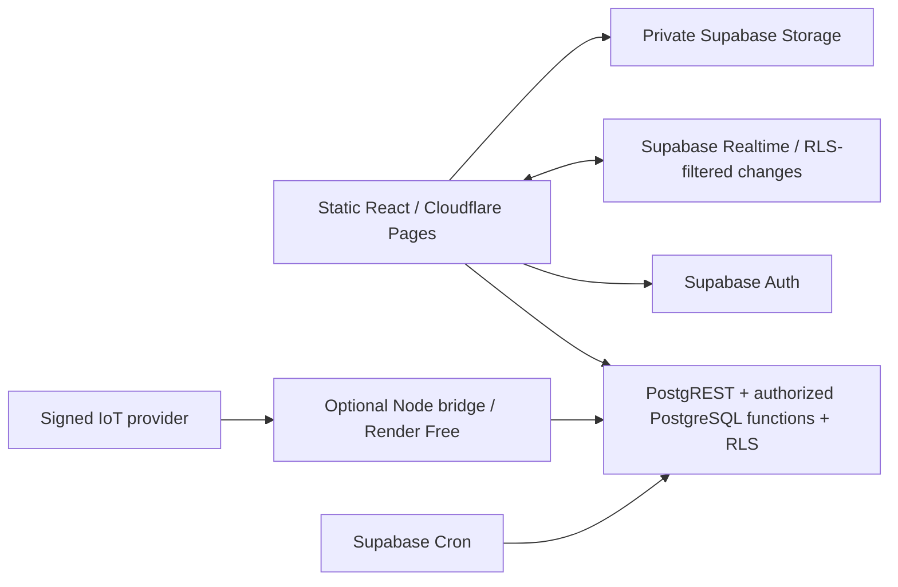

# Architecture

Visitor forms use immutable `visitor_form_versions`, a tenant/site-bound active pointer on `sites`, and a captured `form_version_id` on each new invitation. `visitor_form_responses` ties validated answers and notice timestamps to a visit and its original schema. Raw response tables have RLS and no browser grants; authorized RPCs handle publication, token-bound resolution, atomic registration and audited answer retrieval. Retention clears answers without removing historical schemas. Migration 007 and hosted verification remain pending.

Render is not used for login, reads, invitations, visitor registration/check-in, dispatch, driver GPS or local parking simulation. When the bridge sleeps, external ingestion is delayed/unavailable; stale observations become unknown. Supabase itself remains a single external dependency subject to pausing/quotas/outages.

All domain mutations are transactional SQL RPCs. No app table has client write permissions. Foreign keys scope tenant/site hierarchies. Supabase Auth owns user passwords/sessions; application membership grants are installed by trusted setup. There is no custom password store or privileged self-signup.

Realtime reconnect triggers a complete authorized refetch. A 15-second polling fallback and browser online event also refetch. Site changes remove prior subscriptions and clear data. UI selects at most 100 rows per table; pagination and large deployments remain out of scope.

Entities: tenant → site → memberships/visits/zones/vehicles/rides. Invitation → single visit; zone → authenticated device → ordered event; vehicle → assigned driver → shift-bound GPS history; ride → resident + optional same-site vehicle. Audit records contain record identifiers/actions, no tokens or names.

Private storage is provisioned for future images only, with tenant/site/user path policies and 2 MiB MIME constraints. The UI collects no documents. No public buckets or upload UI are enabled.

## Verification boundaries

The production frontend now builds and runs in Edge. Setup tests and separate contract fixtures execute compiled browser code using the real Supabase SDK; the latter intercept synthetic responses under tests and close synthetic WebSockets, so no application-side fallback or live RLS claim is introduced. Builds for those tests stay under .local/browser-dist; deployable apps/web/dist is untouched by the fixtures. Actual hosted Supabase Auth/RPC/RLS/Realtime and optional Render-to-database connectivity remain separate blocked gates pending configuration.
